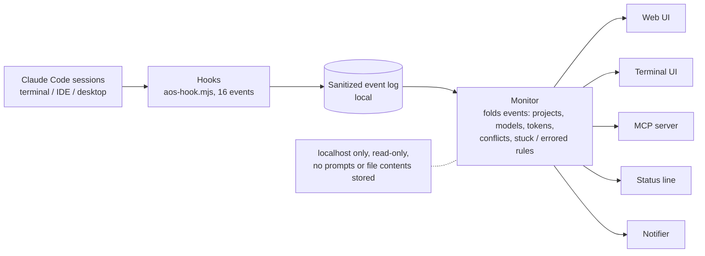

# AOS-1: Agent Orchestration Standard

AOS-1 is a minimal, runtime-agnostic contract for orchestrating several AI agents toward one standing **Goal**. A periodic **Heartbeat** re-evaluates the Goal, reaps stalled work, plans, dispatches ready Tasks, and enforces budgets until the Goal is achieved, blocked, or cancelled. All state lives in plain files, and an append-only event log is the source of truth. The normative text is in [SPEC.md](SPEC.md).

This repository holds the spec, JSON Schemas, a zero-dependency conformance validator, and a reference server, dashboard and heartbeat runner.

<p align="center">
  <a href="docs/screenshots/01-graph-dark.png"></a><br>
  <sub>The live dashboard watching three projects and 19 agents. All screenshots use a synthetic demo dataset (no real projects or paths).</sub>
</p>

## Screenshots

<table>
<tr>
<td><a href="docs/screenshots/01-graph-dark.png"></a><br><sub>Project graph: heart, project hubs, agents, live streams</sub></td>
<td><a href="docs/screenshots/02-graph-light.png"></a><br><sub>Same scene in the light theme</sub></td>
</tr>
<tr>
<td><a href="docs/screenshots/03-agent-drawer-dark.png"></a><br><sub>Agent drawer: current tool, tool feed, tokens, run time, model</sub></td>
<td><a href="docs/screenshots/04-project-drawer-dark.png"></a><br><sub>Project drawer: every agent in the project</sub></td>
</tr>
<tr>
<td><a href="docs/screenshots/05-conflict-and-alerts-dark.png"></a><br><sub>File conflict popover and an alert toast</sub></td>
<td><a href="docs/screenshots/06-replay-dark.png"></a><br><sub>Replay: scrub back through the last hours</sub></td>
</tr>
<tr>
<td><a href="docs/screenshots/07-telemetry-dark.png"></a><br><sub>Telemetry dock with the event stream</sub></td>
<td><a href="docs/screenshots/08-terminal.png"></a><br><sub>Terminal dashboard (aos-dash)</sub></td>
</tr>
</table>

Regenerate with `make screenshots` (needs playwright-core and the monitor running; ffmpeg for the GIF). The data comes from `scripts/demo-state.mjs`, served to the real UI through request interception.

## How it works



## Highlights

- Privacy-first local telemetry: hooks log event and tool names, counts and short labels only, never prompts, command lines, file contents, tool output or error messages.
- Project-graph layout (heart, project hubs, agents) with node and label overlaps ruled out by construction; the terminal layout's no-overlap rules are covered by automated tests.
- Canvas particle streams (adaptive to frame time, paused in background tabs, crisp on high-DPI screens), tried in Safari and Chromium.
- Per-model stuck thresholds, plus errored-agent and file-conflict detection.
- Pan and zoom (wheel, trackpad, pinch, drag, keyboard) with the particle streams staying aligned to the graph.
- Replay: scrub the recorded timeline and see the graph as it was.
- Light and dark themes with checked contrast tokens.
- One plugin ships the hooks, the web UI, a terminal dashboard (`aos-dash`), a read-only MCP server and a macOS notifier.
- Automated test suites for the spec validator, terminal UI, MCP server, notifier and theme contrast (`make test`).

## Quickstart

Requires Node 18+. There are no dependencies to install.

```sh
node server.mjs                       # dashboard + API at http://127.0.0.1:4317
node conformance/validate.mjs         # validate ./state against schemas and the spec's MUSTs
node conformance/validate.mjs path/to/state   # validate another state directory
node conformance/validate.mjs --selftest      # prove the validator catches the negative fixtures
```

The validator exits 0 when the state conforms and 1 when it does not. Each violation is printed as `FAIL: <file>: <message>`. Warnings, such as a stale heartbeat, do not affect the exit code.

## Directory map

```
SPEC.md                 AOS-1 normative specification
README.md               this file
ROADMAP.md              what exists, known limitations, ideas
server.mjs              reference HTTP server (serves ui/ and the state API)
ui/                     dashboard (goal, heartbeat, task board, agents, events, pause/resume/cancel)
heartbeat/              heartbeat runner and config.json
state/                  runtime state (the file-based binding)
  goal.json               Goal
  tasks.json              Task[]
  agents.json             Agent[]
  heartbeat.json          Heartbeat
  events.ndjson           append-only Events, one JSON object per line
schemas/                JSON Schema (draft 2020-12): goal, task, agent, heartbeat, event
conformance/
  validate.mjs            validator with a built-in schema-subset checker
  fixtures/valid/         state directories that must pass
  fixtures/invalid/       state directories that must each fail, one violation per directory
```

## What the validator checks

Schema checks use `type`, `required`, `enum`, `properties`, `items`, `pattern`, `minimum` and `minItems`. The semantic checks are:

- Goal, task, agent and goal-terminal statuses are valid lifecycle values.
- The Goal has a budget (SPEC section 7).
- Every Task has a non-empty `output_contract` and at least one `acceptance` check (section 6).
- Task ids are unique, every `depends_on` reference exists, and there are no dependency cycles.
- `assignee`, `current_task` and `goal_id` references resolve, and `attempts` does not exceed `max_attempts`.
- `events.ndjson` has parseable lines, valid Event shapes, and strictly increasing `seq`.
- Heartbeat liveness is consistent with the age of `ts` (alive under 1.5x, late under 3x, dead at 3x or more of `interval_s`). A terminal Goal must not have a `running` heartbeat.

The validator cannot see past writes, so append-only is checked structurally (monotonic `seq`, parseable lines). Appending only is up to the writer.

## Configuring dispatch

The heartbeat runner starts each `ready` Task by running a shell command. Set it in `heartbeat/config.json` under `dispatch_command`:

```json
{
  "interval_s": 60,
  "dispatch_command": "claude -p \"$AOS_TASK_PROMPT\""
}
```

Keep the exact key names and the variables available to the command in sync with `heartbeat/config.json` and the runner's header comment, which are the authority. The command is the only place a real agent runtime is plugged in. Anything that can be launched from a shell works: the Claude CLI, a script, or an HTTP client. Per SPEC section 7, a command that deploys, sends messages, spends money, or deletes things MUST be gated on human approval recorded as a `human.*` Event.

## Keeping it running

Run the server and the heartbeat as long-lived processes. The heartbeat file is the liveness signal, so a crashed runner shows up as `late` and then `dead` in the dashboard.

Quick, with nohup:

```sh
cd /path/to/agent-orchestration-standard
nohup node server.mjs > server.log 2>&1 &
```

Durable, with launchd on macOS. Save this as `~/Library/LaunchAgents/dev.aos.server.plist`, adjust the paths, then run `launchctl load ~/Library/LaunchAgents/dev.aos.server.plist`:

```xml
<?xml version="1.0" encoding="UTF-8"?>
<!DOCTYPE plist PUBLIC "-//Apple//DTD PLIST 1.0//EN" "http://www.apple.com/DTDs/PropertyList-1.0.dtd">
<plist version="1.0"><dict>
  <key>Label</key><string>dev.aos.server</string>
  <key>ProgramArguments</key><array>
    <string>/usr/local/bin/node</string>
    <string>/path/to/agent-orchestration-standard/server.mjs</string>
  </array>
  <key>WorkingDirectory</key><string>/path/to/agent-orchestration-standard</string>
  <key>RunAtLoad</key><true/>
  <key>KeepAlive</key><true/>
  <key>StandardOutPath</key><string>/tmp/aos-server.log</string>
  <key>StandardErrorPath</key><string>/tmp/aos-server.log</string>
</dict></plist>
```

Use the same pattern, with a different label and the heartbeat entry point, for the heartbeat runner if it is a separate process. Stop with `launchctl unload <plist>`. On Linux, an equivalent systemd unit with `Restart=always` works.

## Claude Code live dashboard (plugin)

Beyond the spec and the reference runner, this repo contains a read-only **live monitor for Claude Code sessions**: it shows every session, project and subagent as a graph (heart -> project hubs -> agents) with live streams, per-agent model, tokens, run time, tool feed, file conflicts, errors and alerts. It is local-only (binds 127.0.0.1) and stores only event and tool names, short labels, counts, and the local folder/file paths it needs for project grouping and file-conflict detection: never prompts, command lines (only a Bash command's first word), file contents, tool output or error messages. Full paths stay in the local log and are never shown in the dashboard, terminal view or MCP output (see `plugin/README.md` for the exact list).

| Part | Where | What |
|---|---|---|
| Hooks | `hooks/aos-hook.mjs`, `plugin/hooks/hooks.json` | Claude Code hooks write sanitized one-line events |
| Monitor | `monitor.mjs` | Folds events into `/api/state`, `/api/history`, replay (`?at=`), alerts, notifications |
| Web UI | `ui/` | The graph, drawers, replay, cost readout, light/dark toggle |
| Terminal UI | `cli/dash.mjs` (`aos-dash`) | The same graph in the terminal (`--once` for a snapshot) |
| MCP server | `plugin/mcp/server.mjs` | Read-only tools so Claude can query the monitor |
| Notifier | `plugin/notify/` | Branded macOS notifications with an app icon |
| Plugin | `plugin/`, `.claude-plugin/marketplace.json` | Packages all of the above; `node plugin/build.mjs` regenerates the copies |

Install (needs Node 18+ and the Claude Code CLI):

```sh
make install        # builds, registers + installs the local plugin, links `aos-dash`, builds the notifier, starts the monitor
make doctor         # checks the whole setup and tells you what to fix
make                # lists every target (test, build, start/stop, statusline, uninstall, ...)
```

Then open http://127.0.0.1:4318 (the monitor starts automatically with a session; set `AOS_NO_AUTOSTART=1` to disable). New sessions pick up the hooks; existing ones need `/reload-plugins`. Project grouping, alerts and the stuck/errored rules can be tuned in the monitor's `live/config.json` (see `plugin/README.md`). Status: personal project, macOS-first. Licensed under the [MIT License](LICENSE).

### Several machines: the hub

To see every machine in one place, run the hub on a server and the shipper on each machine: `make ship
URL=https://<hub>/ingest`. Paths are reduced to project-relative form and token counts are computed on the machine
before anything is sent. See [hub/README.md](hub/README.md).

## Debugging

Open http://127.0.0.1:4318/?debug=1 to show a small on-screen recorder (`ui/debug.js`) that logs layout, canvas, visibility and frame-rate changes with Copy/Clear buttons. It is inert without the flag and never changes the page.

## Security

- **Threat model.** The monitor is a local, read-only observer. It binds `127.0.0.1` only, rejects requests whose `Host` or `Origin` is not `localhost`/`127.0.0.1` (DNS-rebinding and cross-site protection), sends no CORS headers, has no write endpoints, and serves only the files under `ui/` (dotfiles, traversal and symlinks out of `ui/` are refused). Anyone who can run code as your user can read the log anyway; the design goal is that nothing leaves the machine and no other site or user can reach it.
- **What is stored.** See the exact field list under Privacy in [plugin/README.md](plugin/README.md). Agent names and task labels come from Claude Code tool calls, so the UI and terminal view treat them as untrusted text (never rendered as HTML or terminal escape codes). New log files are created owner-only (`0600`, directory `0700`).
- **How to erase.** Delete the data folder: `~/.claude/plugins/data/aos-dashboard-aos-local/live` (or your `AOS_LIVE_DIR`); `make uninstall` removes the plugin but keeps the data.
- **Reporting.** Please open a GitHub issue. For anything sensitive, open an issue asking for a private contact rather than posting details.

## Contributing

Issues and small pull requests are welcome. Edit the sources in the repo root (`monitor.mjs`, `hooks/`, `ui/`, `cli/`), then run `make build` (regenerates the `plugin/` copies) and `make test`; keep it zero-dependency and Node 18 compatible.
